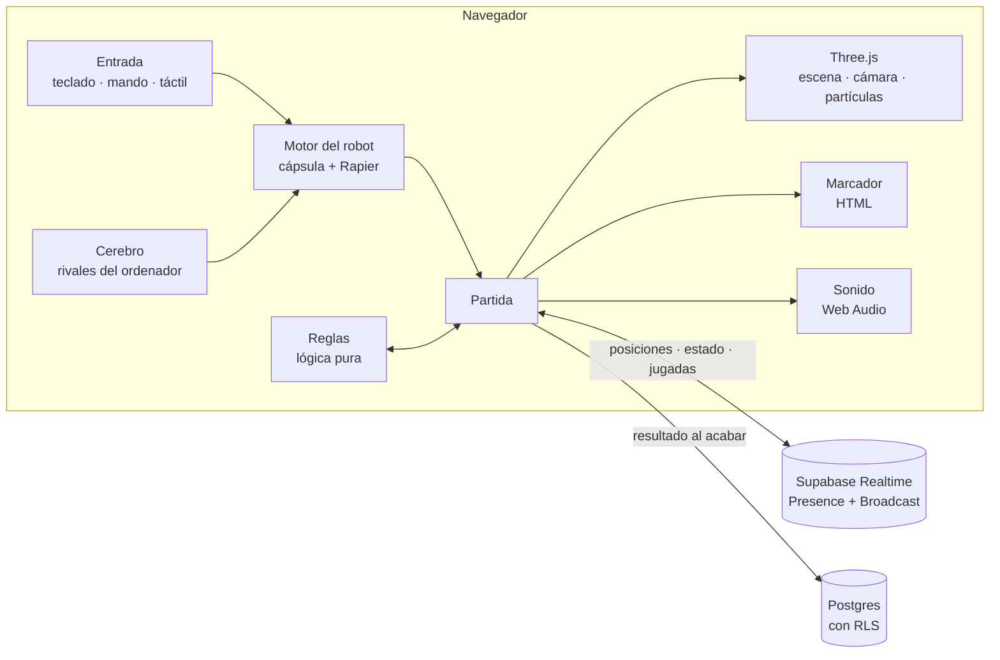

# Chispa

**Juego 3D multijugador de navegador, dibujado como pixel art.** De 2 a 8 robots se disputan una chispa:
quien la lleva carga su batería; los demás le embisten para quitársela. Gana
quien llega al 100 %.

- **10 robots** distintos, cada uno con sus características y su habilidad especial.
- **6 escenarios**, cada uno con su truco: uno del que nadie se cae (sales por
  arriba), una fábrica con cintas, botones y una barredora, un ring diminuto que
  encoge, un glaciar de hielo y viento, una estación con media gravedad…
- **21 objetos** en tres familias: **ventajas** (turbo, escudo, imán, reloj
  parado…), **trampas** (lastre, mareo, encogedor, apagón y la caja sorpresa) y
  **armas** que se guardan y se disparan (cohete, mina, rayo, martillo y bomba
  de pintura).
- **Presión sobre el líder**: a quien lleva la chispa mucho rato seguido le pesa
  y corre menos; si va primero, los que le persiguen corren más; y la caja
  sorpresa da armas al último y trampas al primero. Todo poco a poco y con tope.
- **Pixel art en 3D**: el mundo se pinta a 360 líneas con contornos, tramado y
  texturas de píxel, igual que la interfaz. F4 lo quita y lo pone.
- **En red**, con salas, o **contra el ordenador** (hasta 7 rivales).

Juego de referencia del proyecto 3 del Curso de Programación con IA, construido
sesión a sesión con un agente de programación.


| La Azotea | El Pozo sin Fondo | La Fábrica |
|---|---|---|
|  |  |  |
| **El Ring** | **El Glaciar** | **La Estación** |
|  |  |  |

## Jugar

Publicado en el servidor del centro, en `/juegos/chispa/`.

- **Contra el ordenador**: eliges escenario, ritmo y de 1 a 7 rivales. No necesita red.
- **En red**: «Crear una sala» da un código de cuatro letras. Los demás entran con
  el código o con el enlace (`?sala=ABCD`). Se pasea por la azotea mientras llega
  la gente; el anfitrión elige escenario y ritmo, puede añadir rivales del
  ordenador y empieza la partida.

| Acción | Teclado y ratón | Mando | Móvil |
|---|---|---|---|
| Moverse | WASD o flechas | stick izquierdo | joystick |
| Mirar | ratón (se captura al hacer clic; Escape lo suelta) o flechas | stick derecho | arrastrar a la derecha |
| Saltar | Espacio | A | ▲ |
| Embestir | clic, Mayúsculas o F | X | ⚡ |
| Habilidad especial | clic derecho, E o Q | B | ★ |
| Zoom | rueda del ratón | | |
| Ayuda / datos | H / F3 | | |

## Ponerlo en marcha

Necesita Node 22 o posterior.

```bash
npm install
cp .env.example .env.local   # y rellenarlo (solo hace falta para jugar en red)
npm run dev                  # http://localhost:5173
```

| Orden | Qué hace |
|---|---|
| `npm run dev` | Servidor de desarrollo |
| `npm run tipos` | Comprueba los tipos |
| `npm run pruebas` | 195 pruebas de la lógica (reglas, habilidades, objetos, armas, presión sobre el líder, rivales, mecanismos, interpolación, protocolo) |
| `npm run prueba:red` | Una partida entera con dos navegadores (33 comprobaciones: armas y presión sobre el líder incluidas) |
| `npm run build` | Tipos + pruebas + compilación a `dist/` |
| `npm run desplegar` | Compila y publica en el servidor |
| `npm run migrar` | Crea las tablas del ranking en la base de datos |
| `npm run escenario` | Regenera `azotea.glb` con Blender (cada escenario y los robots tienen su guion en `herramientas/blender/`) |
| `npm run captura` | Guarda una imagen del juego (para que el agente lo vea) |
| `npm run interfaz` | Regenera las imágenes de la interfaz (`public/ui/`) y el CSS de los iconos |
| `npm run validar` | Prueba de humo: entra en cada escenario con cada robot y mira que no haya errores |
| `npm run partidas` | Simula partidas enteras y cuenta cambios de manos, rachas y diferencias: para medir el equilibrio antes y después de tocar una regla |

## Cómo está hecho



| Carpeta | Qué hay |
|---|---|
| `src/nucleo` | El bucle (paso fijo de 1/60 s) y la entrada |
| `src/mundo` | Lo que se ve: escena, cielo y ambientes, el cargador de escenarios, cámara, objetos, partículas |
| `src/jugador` | Los robots: fichas, modelos, animación (con esqueleto o por código) y motor de movimiento |
| `src/fisica` | Rapier: escenario, ascensor y cápsulas |
| `src/reglas` | Las reglas y las habilidades, como lógica pura (sin three, DOM ni red) |
| `src/bots` | Los rivales manejados por el ordenador |
| `src/red` | Supabase: conexión, sala, protocolo e interpolación |
| `src/datos` | Ficha del jugador, resultados y ranking |
| `src/ui` | Menú, marcador, vestíbulo, ayuda y controles táctiles |
| `src/audio` | Efectos y música con Web Audio |
| `src/partida.ts` | Lo junta todo en una partida |
| `herramientas/` | Guiones de Blender (6 escenarios y 9 robots), captura, prueba de dos navegadores, despliegue |
| `supabase/migraciones/` | Las tablas y sus políticas |
| `docs/` | Diseño, decisiones, cuaderno de cada sesión y de cada ampliación, playtest y postmortem |

### El aspecto: pixel art en 3D

El juego es 3D de verdad (cámara libre, físicas, sombras), pero se dibuja como
pixel art. La escena se pinta en una imagen de 360 líneas y un sombreador la
amplía sin suavizar, dibuja los contornos a partir de la profundidad y reduce
los tonos con tramado. Las superficies llevan texturas de píxel de cuatro tonos,
generadas por código y proyectadas en metros (16 téxeles por metro en todo el
mundo), sin UV. El porqué de cada cosa, en
[`docs/ampliaciones/09-pixel-art-3d.md`](docs/ampliaciones/09-pixel-art-3d.md).

### La interfaz

HTML y CSS encima del lienzo 3D, en pixel art. Las imágenes (marcos de 9 trozos,
botones, 51 iconos, logotipo y animaciones por fotogramas; 6 kB entre todas) no
están dibujadas a mano: las genera `herramientas/pixel/generar.mjs` a partir de
una paleta de 20 colores. Todo junto, en
[`docs/capturas/interfaz-hoja.png`](docs/capturas/interfaz-hoja.png); el porqué,
en [`docs/ampliaciones/08-interfaz-pixel.md`](docs/ampliaciones/08-interfaz-pixel.md).

### El multijugador, en cuatro líneas

- Cada jugador simula **su** robot y envía su posición 15 veces por segundo.
- El **anfitrión** (el más antiguo de la sala) ejecuta las reglas y envía el estado
  5 veces por segundo y cada jugada al momento. Si se va, hereda el siguiente.
- Los demás robots se pintan **interpolados**, 100 ms en el pasado.
- Al acabar, cada jugador apunta **su** resultado en la base de datos; las
  políticas (RLS) impiden escribir el de otro.

| Mensaje | De quién | Qué lleva |
|---|---|---|
| `p` | cada jugador (y el anfitrión por los rivales) | posición, giro, animación, instante |
| `e` | anfitrión | estado de la partida, rivales que hay, escenario y ritmo |
| `j` | anfitrión | jugadas: coge, roba, empuja, objeto, especial, congela, mecanismo, fin… |
| `g` | cualquiera → anfitrión | «he embestido a X» |
| `x` | cualquiera → anfitrión | «uso mi habilidad» |

### Lo que pesa

| Fichero | En bruto | Con gzip |
|---|---|---|
| Físicas (Rapier) | 4 231 kB | 1 604 kB |
| Three.js | 653 kB | 161 kB |
| Robot clásico (`robot.glb`) | 453 kB | 132 kB |
| Los otros nueve robots (`robots.glb`) | 573 kB | 62 kB |
| Red (supabase-js) | 211 kB | 54 kB |
| El juego | 121 kB | 42 kB |
| Los seis escenarios | 2 235 kB | 302 kB |
| **Total** | **8 479 kB** | **2 357 kB** |

Al entrar se descargan las librerías, los robots y un escenario (unos 2,1 MB
comprimidos). Los demás escenarios se bajan solo cuando se eligen.

Las librerías van en ficheros aparte con el hash en el nombre: el navegador las
guarda un año y una versión nueva solo vuelve a bajar los 42 kB del juego.

## Límites conocidos

- **El arbitraje no es a prueba de trampas.** Las reglas las ejecuta el navegador
  del anfitrión y cada jugador informa de su propia posición y de su resultado.
  Los límites de la base de datos recortan lo que se puede falsear, no lo impiden.
- **Si el anfitrión tiene mala conexión**, la partida va mal para todos.
- **Las físicas pesan 1,6 MB** comprimidas: van con el WebAssembly incrustado.
- Los rivales del ordenador se caen más que una persona en los escenarios difíciles (hielo, ring).
- Sin chat ni espectadores.

## Créditos y licencia

Código bajo licencia [MIT](LICENSE). Modelos, herramientas y sus licencias, en
[CREDITOS.md](CREDITOS.md). Lo hecho en cada sesión, en
[`docs/sesiones/`](docs/sesiones/), y en cada ampliación, en
[`docs/ampliaciones/`](docs/ampliaciones/); las decisiones, en
[`docs/decisiones.md`](docs/decisiones.md); los cambios, en
[CHANGELOG.md](CHANGELOG.md).
